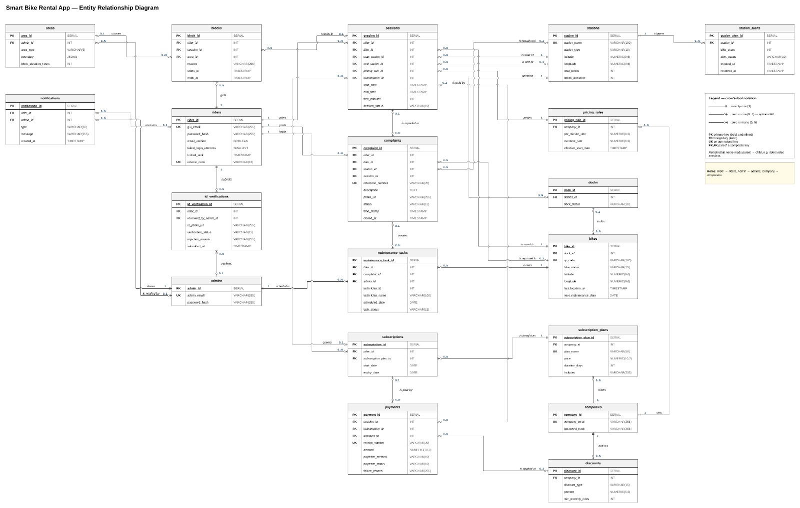

# Smart Bike Rental App — PedalUp

**CSEN303 Software Engineering · German International University (GIU) · Milestone 2: Database Design**

This repository contains the database design of the Smart Bike Rental App: the Entity-Relationship
Diagram (ERD), and the PostgreSQL scripts that create the database and fill it with sample data.

---

## Team

| # | Name |
|:-:|------|
| 01 | Omar Khalaf |
| 02 | Yahia Amr |
| 03 | Yusuf Sherif |
| 04 | Ziad Bahaa |
| 05 | Ahmed Mohamed |
| 06 | Aley Shaheer |
| 07 | Yusuf Osama |
| 08 | Omar Khashaba |

---

## Repository structure

```
smart-bike-rental-pedalup/
├── README.md                        team info, ERD, traceability, database info
├── docs/
│   ├── erd.png                      exported image of the ERD
│   └── erd.drawio                   editable draw.io source
└── schema/
    ├── 01_create_tables.sql         tables, keys and foreign keys
    ├── 02_constraints_indexes.sql   CHECK constraints and indexes
    └── 03_seed_data.sql             sample rows for testing
```

---

## Entity-Relationship Diagram

**Editable source:** [`docs/erd.drawio`](docs/erd.drawio) — open it at [app.diagrams.net](https://app.diagrams.net)



| Property | Details |
|---|---|
| **Notation** | Crow's-foot (a legend is on the diagram) |
| **Size** | 19 tables · 32 relationships |
| **Relationships** | Every line has a name that reads parent → child (e.g. *riders* **rides** *sessions*) and a cardinality at both ends: `1`, `0..1`, `0..N` |
| **Roles** | Each role has its own table: Rider → `riders`, Admin → `admins`, Company → `companies` |
| **Many-to-many** | None left unresolved: a payment applies at most one discount (`payments.discount_id`) |
| **Naming** | Lowercase `snake_case`, plural table names, primary keys named `<table>_id` |
| **Normal form** | 3NF |

---

## Traceability: entities → user stories

| Entity | User stories |
|--------|--------------|
| `riders` | US-001, US-002, US-003, US-017, US-021 |
| `admins` | US-022 – US-028 |
| `companies` | US-029, US-030 |
| `id_verifications` | US-002, US-024 |
| `notifications` | US-009, US-010, US-019, US-024 |
| `stations` | US-004, US-011, US-012, US-022 |
| `docks` | US-004, US-011, US-012 |
| `bikes` | US-005, US-006, US-007, US-023, US-026 |
| `station_alerts` | US-025 |
| `areas` | US-004, US-010, US-028 |
| `pricing_rules` | US-008, US-009, US-030 |
| `subscription_plans` | US-015, US-030 |
| `subscriptions` | US-015, US-021 |
| `sessions` | US-006, US-008, US-009, US-011, US-012, US-021 |
| `discounts` | US-016, US-017, US-030 |
| `payments` | US-013, US-014, US-016 |
| `blocks` | US-006, US-010, US-028 |
| `complaints` | US-018, US-027 |
| `maintenance_tasks` | US-026, US-027 |

> **Note:** US-020 (chatbot) and US-029 (dashboard) need no table of their own. The chatbot stores
> nothing (it can open a report in `complaints`), and the dashboard is computed from `sessions`,
> `payments` and `subscriptions`.

---

## Database

| Item | Value |
|---|---|
| **DBMS** | PostgreSQL |
| **Database name** | `smart_bike_rental` |
| **Scripts** | `schema/` folder — run them in numeric order on an empty database |

| Script | What it does |
|--------|--------------|
| [`01_create_tables.sql`](schema/01_create_tables.sql) | Creates all 19 tables in dependency order with primary keys, `UNIQUE` keys, `NOT NULL`, `DEFAULT`s and all 32 foreign keys with their `ON DELETE` rules |
| [`02_constraints_indexes.sql`](schema/02_constraints_indexes.sql) | Adds business-rule `CHECK` constraints, partial unique indexes (one active ride per rider and per bike), an index on every foreign key, and query indexes |
| [`03_seed_data.sql`](schema/03_seed_data.sql) | Inserts sample rows into every table (stations, docks, bikes, riders, rides, payments, …) |

### How to run (pgAdmin 4)

1. Right-click **Databases → Create → Database…**, name it `smart_bike_rental`, and save.
2. Select the database and open **Tools → Query Tool**.
3. Open each script (folder icon) in numeric order and run it with **F5**.
4. Refresh **Schemas → public → Tables**: **19 tables** are listed. Script 03 ends by printing the row count of every table.
